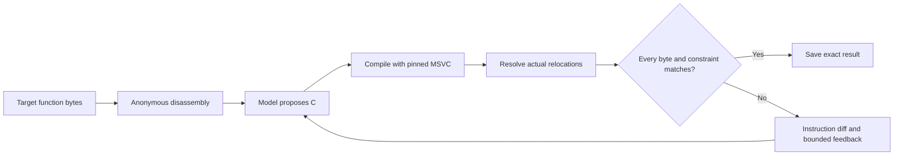

# Unbake

**Can reconstructed C compile back to exactly the same machine code?**

Unbake is a Windows research prototype for matching decompilation. It combines anonymous assembly, AI-generated C, a pinned MSVC compiler, and a strict byte checker. A candidate succeeds only when its compiled function body matches every target byte after resolving supported relocations and satisfying the checker's constraints.

Built by **Chase** with AI assistance for implementation, investigation, and review. Claude generates the recorded solver candidates; assisted local analysis and compiler experiments are reported separately from autonomous model results.

This repository is a public research showcase. It contains a curated account of recorded experiments and a sanitized [evidence summary](evidence/results.json). The implementation, executables, third-party source, generated candidates, and raw provider logs are not distributed here.

The latest completed investigation brought a **663-byte function to five differing bytes**, with all 13 relocations and its defined string constant verified. Two earlier offline investigations reached exact 388-byte and 223-byte matches. The five-byte gap remains unresolved.

## The loop

The diagnostic score aligns instructions so an inserted instruction does not make an entire suffix look unrelated. That score guides investigation; even zero aligned edits can hide different encodings. Only the strict checker accepts a match.

## Recorded results

Snapshot cutoff: **October 3, 2026, 14:59:51 CDT**. These figures come from saved experiment records inspected for this showcase; the showcase preparation did not rerun the compiler, tests, or model.

| Experiment | Recorded result | What it establishes |
| --- | --- | --- |
| Reference answer-key validation | **662 / 662** function bodies passed | A reproducible reference subset from five ImGui translation units, 20–1,994 bytes, matched the recorded executable under MSVC 19.44.35229. This is answer-key validation, not 662 model solutions. |
| Eight-function model baseline | **1 / 7** scored functions exact; **1** infrastructure failure | One attempt per function, eight call attempts total, no retries. The failed call is excluded from the denominator. |
| ItemAdd local investigation | **388 / 388 bytes exact** | An offline source refinement matched the body, including five relocations against three bindings. The model baseline remains unchanged. |
| Three-function paired prompt comparison | **0 / 3 exact** in each condition | Six calls compared generic guidance with load-before-write guidance on a small selected sample. |
| BeginDragDropTarget local investigation | **223 / 223 bytes exact** | A fresh control and one equivalent condition rewrite produced a match with two local compiler runs and zero new model calls. |
| Fresh local-repair evaluation | **0 / 3 exact** | Three model calls and three candidate compilations; no candidate reached the repair gate, so no repair variants were compiled. |
| Local coverage follow-up | **No new exact matches**; known 223-byte match reproduced | Saved-candidate coverage improved. The recorded suite passed 109 tests; effectiveness on fresh eligible near misses remains unmeasured. |
| 308-byte branch-construction investigation | **9 aligned edits remain** | Six local compiles did not improve the saved baseline. No exact match. |
| 663-byte aggregate-store investigation | **5 differing bytes**, down from diagnostic score 12 | Seven local compiles; best candidate has five aligned edits and zero constraints. No exact match. |
| 663-byte entry continuation | **Five-byte gap unchanged** | Eight further C/C++ compilations tested pointer and aggregate source forms. Independent audit confirmed the remaining gap. |

A subsequent feedback experiment is **in progress at the snapshot cutoff**, with a budget of one provider call and one compile. Its event ledger records one provider-call reservation at 14:59:51 CDT; its manifest records zero compiles and no completed result. It is excluded from completed outcome counts. Later results may supersede this snapshot.

The sample sizes and selection rules do not support a whole-game or general decompilation accuracy claim. Results from separate experiments should not be pooled into one success rate.

## What the investigations found

### A load's timing can decide the match

The ItemAdd investigation began with a model candidate that differed by 55 aligned instruction edits. Preserving a context pointer and correcting return layout narrowed the gap. The decisive change captured a 16-byte rectangle before intervening flag/status writes, then used the captured value later.

That ordering produced the target's instruction scheduling and register allocation. It also preserves a read/write dependency when memory overlaps, so it is not presented as an arbitrary semantics-preserving rewrite of the earlier candidate. The saved review manually encoded the five relocation displacements independently of the match comparator and compared all 388 bytes to the installed executable.

### Equivalent conditions can produce different encodings

In BeginDragDropTarget, inverting an integer bit test and swapping its two literal choices preserved the selected value but changed MSVC's immediate order and conditional-move instruction. A three-edit near miss became an exact 223-byte match.

The recorded independent check parsed the COFF object without the project's COFF, executable-reader, or match modules, applied three relocations, and compared every byte with the installed executable. A bounded automated repair pass later reproduced this known case. That replay is a regression result, not held-out evidence of generalization.

### Aggregate stores closed most of a larger gap

For the 663-byte target, replacing four individual float stores with one four-float aggregate assignment reproduced the target's grouped XMM-register restores and final global reload placement. The diagnostic score fell from 12 (11 edits plus one constraint error) to five edits with zero constraints.

The remaining differences are five entry bytes involving RBX/RDI register choices. Every byte from offset `0x66` to the end matches under the recorded bindings. An eight-compilation continuation tested explicit context merges, C++17, and aggregate initialization without closing the gap. Its independent audit reconstructed the bodies, verified all 13 relocations and the defined string constant, and confirmed that the result is still nonexact. No machine-code bytes were patched.

## Engineering focus

- **Strict acceptance:** only actual relocation fields may change, repeated references must agree, and supported read-only constants must match.
- **Anonymous model input:** executable solver prompts omit reference source and answer-key function names; experiment manifests preserve prompt and input hashes.
- **Bounded experiments:** frozen targets, code, compiler, and call budgets; infrastructure failures stop execution and remain visible in the record.
- **Local repair:** conservative integer-condition rewrites, a near-match gate, compile caps, and separate attribution for model results and offline repairs.
- **Independent checking:** exact local results include separate relocation reconstruction, reducing dependence on a single match implementation.

The prototype is built with Python, MSVC/COFF and Windows PE tooling, x64 disassembly, and a Claude-backed candidate-generation loop.

## Current limits

The linked-executable checker covers one contiguous x64 function body with supported REL32 variants, ADDR64, or ADDR32NB relocations. Distant cold chunks and constant tables containing relocations are unsupported. Mutable data, external callee implementations, and whole-program behavior are outside this check. Function-body equality does not recover original variable names, types, or source, and does not compare all object metadata.

The answer key is an ImGui subset selected for reproducible matching, not a complete inventory or rebuild of Barony. Earlier exploratory runs used superseded keys and are not used as the headline evidence here.

The latest coverage work recognizes some unwrapped masked-literal ternaries and a narrowly verified MSVC stack-protection helper form. One saved candidate still scores 84, outside the repair gate; two others remain rejected for missing verified runtime counterparts. Saved-scalar conditions require further data-flow work. No new exact result is claimed from these changes.

## Evidence and next question

See [evidence/results.json](evidence/results.json) for compact metrics and the exact-body hashes, and [evidence/README.md](evidence/README.md) for provenance and verification limits. These summaries make the claims inspectable, but do not provide the private inputs needed to reproduce the experiments independently.

The next meaningful measurement is a separately frozen evaluation of fresh, eligible near misses: can the bounded repair pass add exact matches without weakening acceptance? That outcome remains open.
